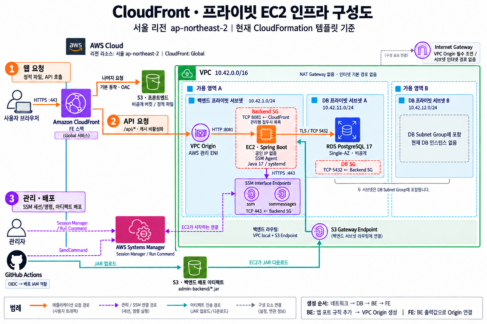

## Noticeboard Admin 인프라 배포

- 이 폴더의 CloudFormation 템플릿은 서울 리전(`ap-northeast-2`)에 네트워크, PostgreSQL DB, 백엔드 EC2, 프런트엔드 S3/CloudFront를 **각각 별도 스택**으로 생성한다
- CloudFormation 배포 자체에는 별도 요금이 없으며 배포로 생성되는 AWS 리소스의 유지 및 사용에 따라 비용이 발생한다

| 템플릿 | 만드는 리소스 | 선행 조건 |
| --- | --- | --- |
| `deploy-admin-network-stack.yaml` | VPC, 프라이빗 서브넷, 보안 그룹, S3/SSM VPC 엔드포인트 | 없음 |
| `deploy-admin-db-stack.yaml` | PostgreSQL RDS와 관리형 비밀번호 | 네트워크 스택 출력값 |
| `deploy-admin-be-stack.yaml` | EC2, 배포용 S3 버킷, IAM 정책, CloudFront 접근 허용 규칙, VPC Origin | 네트워크 스택 출력값, 기존 GitHub 배포 역할, CloudFront 관리형 접두사 목록 ID |
| `deploy-admin-fe-stack.yaml` | 정적 파일용 S3 버킷과 CloudFront, `/api/*` 백엔드 연결 | BE 스택 출력값과 전역에서 고유한 S3 버킷 이름 |

### 인프라 구성도


## 배포하기
- 로그인하기
```powershell
# ap-northeast-2 사전 설정
> aws login --profile dev 
> aws sts get-caller-identity --profile dev
```

- 템플릿 문법 검사
```powershell
env:AWS_CLI_FILE_ENCODING = "UTF-8"

Get-ChildItem -Filter 'deploy-admin-*-stack.yaml' | ForEach-Object {
    aws cloudformation validate-template `
      --template-body "file://$($_.Name)" `
      --region $Region --profile $Profile | Out-Null
    if ($LASTEXITCODE -ne 0) { throw "$($_.Name) 검증 실패" }
}
```

### 1. 네트워크 배포
```powershell
$NetworkStack = 'notice-admin-network-dev'
aws cloudformation deploy `
  --template-file .\deploy-admin-network-stack.yaml `
  --stack-name $NetworkStack --profile dev
```

다음 단계에 전달할 출력값을 가져옵니다.

```powershell
$network = aws cloudformation describe-stacks `
  --stack-name $NetworkStack --profile dev `
  --output json | ConvertFrom-Json
$n = @{}
$network.Stacks[0].Outputs | ForEach-Object { $n[$_.OutputKey] = $_.OutputValue }
$n
```

### 2. DB 배포
- 먼저 서울 리전에서 사용 가능한 PostgreSQL 17 세부 버전 조회
```powershell
aws rds describe-db-engine-versions `
  --engine postgres `
  --query "DBEngineVersions[?starts_with(EngineVersion, '17.')].EngineVersion" `
  --output text --profile dev
```
- 위에서 확인한 세부 버전 중 하나를 DbVersion 변수에 저장
```powershell
$DbVersion = '17.10' 
$DbStack = 'notice-admin-db-dev'
aws cloudformation deploy `
  --template-file .\deploy-admin-db-stack.yaml `
  --stack-name $DbStack `
  --parameter-overrides `
    "DatabaseEngineVersion=$DbVersion" `
    "DatabasePrivateSubnetA=$($n.DatabasePrivateSubnetA)" `
    "DatabasePrivateSubnetB=$($n.DatabasePrivateSubnetB)" `
    "DatabaseSecurityGroup=$($n.DatabaseSecurityGroup)" `
    "AvailabilityZone=$($n.AvailabilityZone)" `
  --profile dev
```


### 3. 백엔드 인프라 배포
- 먼저 같은 리전의 CloudFront 관리형 접두사 목록 ID를 조회합니다. 이 목록에는 AWS가 관리하는 CloudFront 오리진 연결용 IP 범위가 들어 있습니다. [AWS 연결 요건](https://docs.aws.amazon.com/AmazonCloudFront/latest/DeveloperGuide/private-content-vpc-origins.html)
```powershell
$BackendStack = 'notice-admin-be-dev'
$DeployRoleName = 'GitHubActionsDeployRole' # 계정에 이미 있는 역할 이름
$BackendAppPort = 8081 # 실제 백엔드 앱의 HTTP 포트와 일치시킴
$CloudFrontPrefixListId = aws ec2 describe-managed-prefix-lists `
  --filters 'Name=prefix-list-name,Values=com.amazonaws.global.cloudfront.origin-facing' `
  --query 'PrefixLists[0].PrefixListId' --output text `
  --region $Region --profile $Profile
if ($LASTEXITCODE -ne 0 -or [string]::IsNullOrWhiteSpace($CloudFrontPrefixListId) -or $CloudFrontPrefixListId -eq 'None') {
    throw 'CloudFront 관리형 접두사 목록 ID를 조회하지 못했습니다.'
}
$CloudFrontPrefixListId
```
- 백엔드 스택 배포
```powershell
aws cloudformation deploy `
  --template-file .\deploy-admin-be-stack.yaml `
  --stack-name $BackendStack `
  --parameter-overrides `
    "ExistingDeployRoleName=$DeployRoleName" `
    "BackendSecurityGroup=$($n.BackendSecurityGroup)" `
    "BackendPrivateSubnet=$($n.BackendPrivateSubnet)" `
    "BackendAppPort=$BackendAppPort" `
    "CloudFrontPrefixListId=$CloudFrontPrefixListId" `
  --capabilities CAPABILITY_IAM `
  --region $Region --profile $Profile
if ($LASTEXITCODE -ne 0) { throw 'BE 스택 배포 실패' }
```

#### SSM 으로 접속하여 초기 설정 성공했는지 확인하기
> EC2 → 인스턴스 → notice-admin-be-dev-bakend → 연결 → Session Manager

- 초기 설정 완료 여부
```bash
$ sudo cloud-init status --wait
status: done
```
- 초기 설정 스크립트가 마지막까지 실행됐는지
```bash
$ ls -l /opt/noticeboard-admin/bootstrap-complete
```
- Java 설치 여부
```bash
$ java -version
# 설치가 인되지 않으면 초기 설정 로그 확인
$ sudo tail -n 100 /var/log/cloud-init-output.log
```


### 4. 프런트엔드 인프라 배포

- BE 출력의 `BackendPrivateDnsName`과 `BackendVpcOriginId`를 FE의 같은 이름을 가진 필수 파라미터로 전달합니다. 

```powershell
$FrontendStack = 'noticeboard-admin-fe-stack'
$FrontendBucket = 'notice-admin-fe-dev' # 실제 고유 이름으로 교체
$backendJson = aws cloudformation describe-stacks `
  --stack-name $BackendStack --profile dev --output json
if ($LASTEXITCODE -ne 0) { throw 'BE 스택 출력값 조회 실패' }
$backend = $backendJson | ConvertFrom-Json -ErrorAction Stop
$b = @{}
$backend.Stacks[0].Outputs | ForEach-Object { $b[$_.OutputKey] = $_.OutputValue }
if (-not $b.BackendPrivateDnsName -or -not $b.BackendVpcOriginId) {
    throw 'BE 스택의 BackendPrivateDnsName 또는 BackendVpcOriginId 출력값이 없습니다.'
}
$b
```
- 프론트 스택 배포
```powershell
aws cloudformation deploy `
  --template-file .\deploy-admin-fe-stack.yaml `
  --stack-name $FrontendStack `
  --parameter-overrides `
    "BucketName=$FrontendBucket" `
    "BackendPrivateDnsName=$($b.BackendPrivateDnsName)" `
    "BackendVpcOriginId=$($b.BackendVpcOriginId)" `
  --profile dev
if ($LASTEXITCODE -ne 0) { throw 'FE 스택 배포 실패' }
```

- 빌드 결과가 `dist` 폴더라면 해당 프로젝트에서 `aws s3 sync .\dist\ "s3://$FrontendBucket/" --delete --region $Region --profile $Profile`을 실행합니다. 
- `--delete`는 버킷에만 있던 파일도 지우므로 업로드 대상을 확인한 뒤 사용합니다. 
- 접속 주소는 출력값 `CloudFrontDomainName`에 `https://`를 붙인 값입니다. 이 템플릿에는 SPA 경로 새로고침용 오류 응답 설정이 없습니다.


#### 배포 결과 확인

```powershell
foreach ($Stack in @($NetworkStack, $DbStack, $BackendStack, $FrontendStack)) {
    aws cloudformation describe-stacks `
      --stack-name $Stack --profile dev `
      --query 'Stacks[0].{Status:StackStatus,Outputs:Outputs}' --output json
}
```

## 리소스 정리하기
#### 프로필 설정
```powershell
$Profile = 'dev'
```
#### 1. FE 삭제 
```powershell
aws s3 rm s3://notice-admin-fe-dev/ --recursive `
  --profile $Profile

if ($LASTEXITCODE -ne 0) { throw 'FE 버킷 비우기 실패' }

aws cloudformation delete-stack `
  --stack-name noticeboard-admin-fe-stack `
  --profile $Profile

if ($LASTEXITCODE -ne 0) { throw 'FE 스택 삭제 요청 실패' }

aws cloudformation wait stack-delete-complete `
  --stack-name noticeboard-admin-fe-stack `
  --profile $Profile

if ($LASTEXITCODE -ne 0) { throw 'FE 삭제 상태를 확인하세요. 다음 단계는 진행하지 마세요.' }
```
#### 2. BE 삭제
```powershell
aws cloudformation delete-stack `
  --stack-name notice-admin-be-dev `
  --profile $Profile

if ($LASTEXITCODE -ne 0) { throw 'BE 스택 삭제 요청 실패' }

aws cloudformation wait stack-delete-complete `
  --stack-name notice-admin-be-dev `
  --profile $Profile

if ($LASTEXITCODE -ne 0) { throw 'BE 삭제 상태를 확인하세요. 다음 단계는 진행하지 마세요.' }
```
- BE 배포용 S3 버킷 삭제
```powershell
aws s3 rb s3://notice-admin-be-dev-artifactbucket-ypt6whnairot `
  --force --profile $Profile

if ($LASTEXITCODE -ne 0) { throw 'BE 배포 버킷 삭제 실패' }
```
#### 3. DB 삭제 
```powershell 
aws cloudformation delete-stack `
  --stack-name notice-admin-db-dev `
  --profile $Profile

if ($LASTEXITCODE -ne 0) { throw 'DB 스택 삭제 요청 실패' }

aws cloudformation wait stack-delete-complete `
  --stack-name notice-admin-db-dev `
  --profile $Profile

if ($LASTEXITCODE -ne 0) { throw 'DB 삭제 상태를 확인하세요. 네트워크 삭제는 진행하지 마세요.' }
```
#### 4. 네트워크 삭제 
```powershell 
aws cloudformation delete-stack `
  --stack-name notice-admin-network-dev `
  --profile $Profile

if ($LASTEXITCODE -ne 0) { throw '네트워크 스택 삭제 요청 실패' }

aws cloudformation wait stack-delete-complete `
  --stack-name notice-admin-network-dev `
  --profile $Profile

if ($LASTEXITCODE -ne 0) { throw '네트워크 삭제 상태를 확인하세요.' }
```


## 참고
[AWS CLI CloudFormation deploy](https://docs.aws.amazon.com/cli/latest/reference/cloudformation/deploy.html), [템플릿 검증](https://docs.aws.amazon.com/cli/latest/reference/cloudformation/validate-template.html), [RDS 엔진 버전 조회](https://docs.aws.amazon.com/cli/latest/reference/rds/describe-db-engine-versions.html)
